# NLCL

轻量化 Minecraft Java 启动器，使用 Python + Flet，Windows 优先。

当前完成：

- **模块 1**：扫描并展示本地 `.minecraft` 中已有的游戏版本。
- **模块 2**：版本下载：原版、Fabric、Forge，配套 Java 推荐/下载和加载器安装。
- **模块 3**：版本详情（mods / 资源包 / 光影 / 整合包清单）与两次确认的安全删除。
- **模块 4**：微软账号 / 离线账号登录，账号持久化、切换和登出。
- **模块 5**：Java 17 路径校验、内存分配和自定义 JVM 参数设置。
- **模块 6**：非模态启动控制台、多实例并发、版本完整性检查、实时日志和已结束实例清理。
- **模块 7**：局域网端口识别、地址复制和直连加入；不内置公网穿透。
- **模块 8**：局域网房间扫描、玩家/版本识别、收藏和一键加入、联机二维码。
- **模块 9**：Java 智能预检、一键下载适配 Java 并绑定到单个实例。
- **模块 10**：实例轻量快照：saves/config/options.txt 的创建、备注、列表与回滚。
- **模块 11**：日志语义标签：模组冲突、Java 不兼容、资源加载失败和正常信息。
- **模块 12**：JAR / Modrinth 整合包导入与独立实例创建。
- **模块 13**：全局等比缩放布局、固定基准画布、950×500 最小窗口和最大缩放限制。
- **模块 14**：深色原版 / 浅色 / 柔和灰绿三套全局主题与持久化。
- **模块 15**：账号入口迁移到侧栏顶部、皮肤头像和皮肤管理。
- **模块 16**：独立设置页面：Java/内存、下载、限速、日志、主题、账号皮肤。

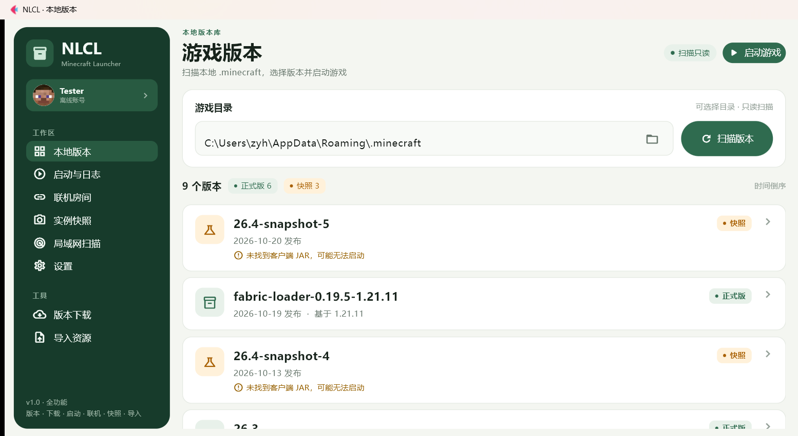

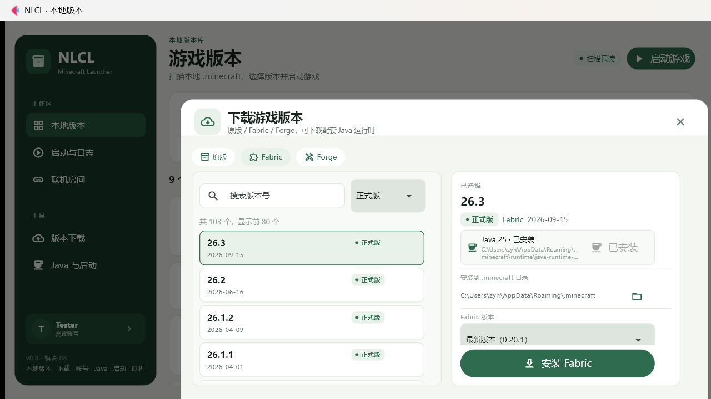

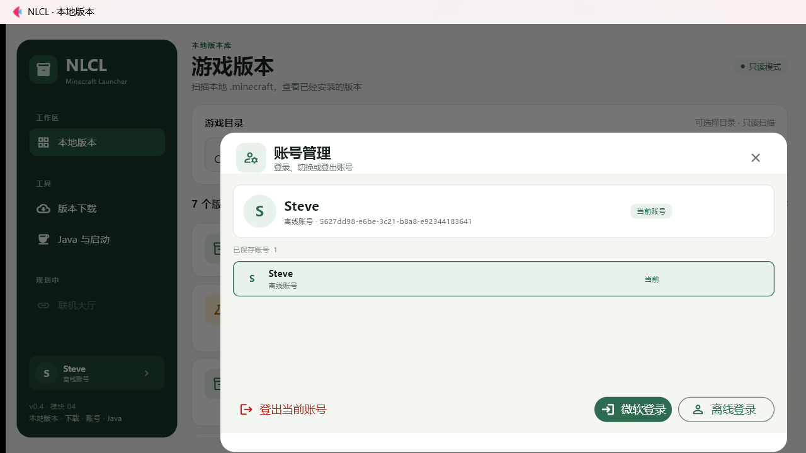

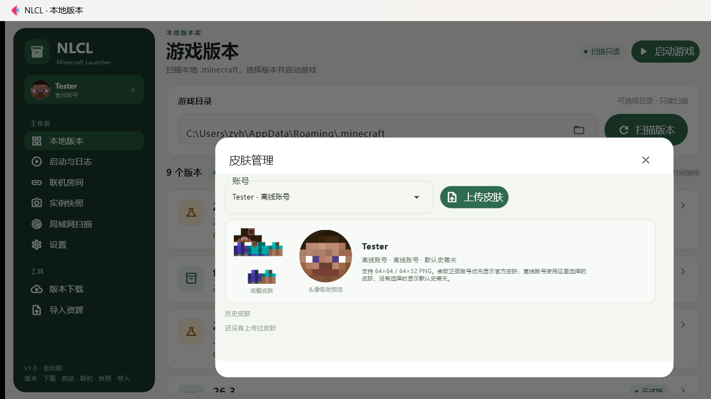

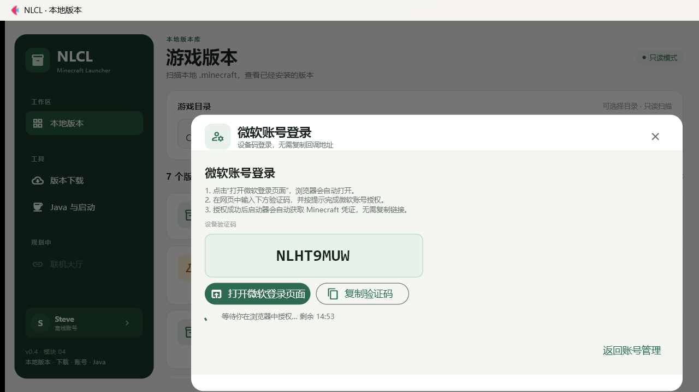

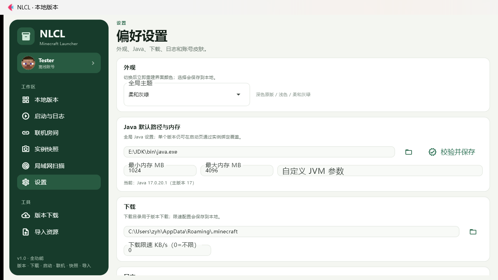

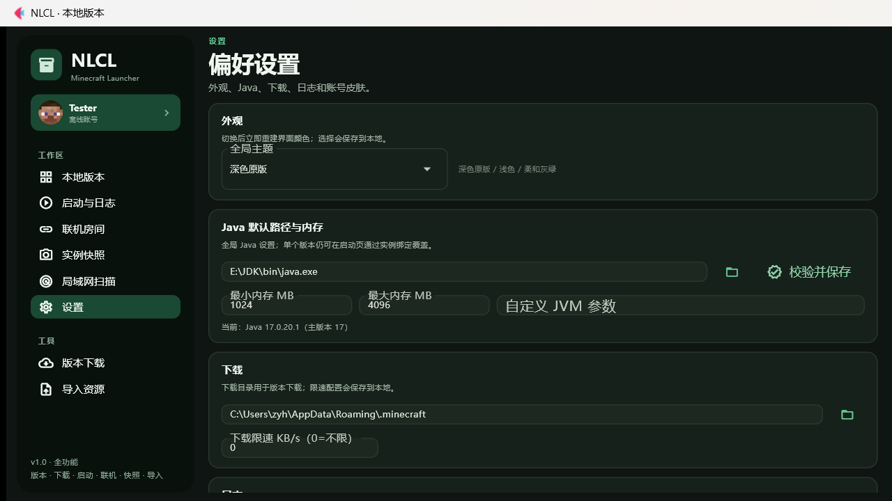

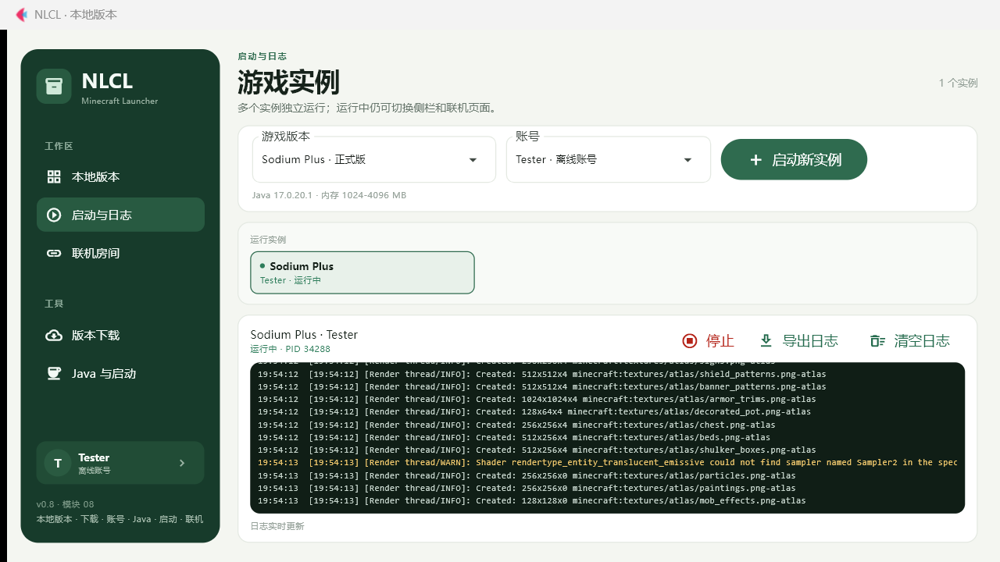

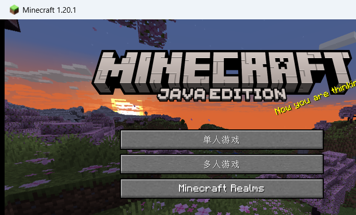

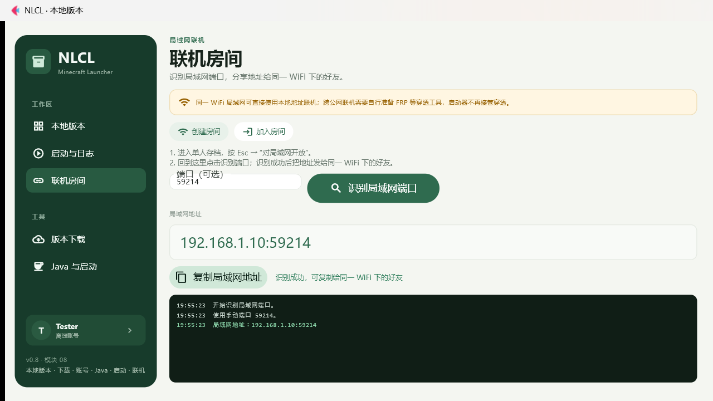

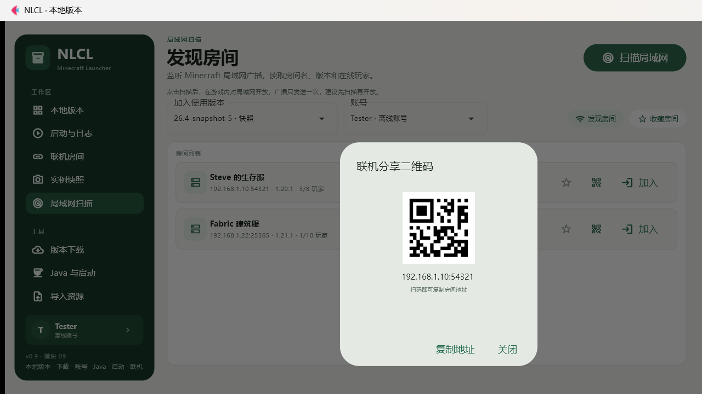

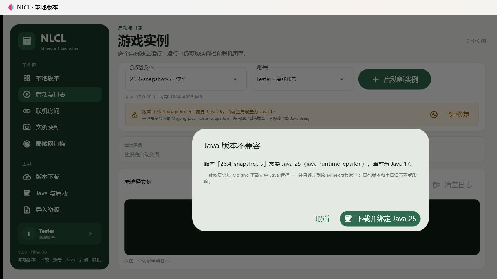

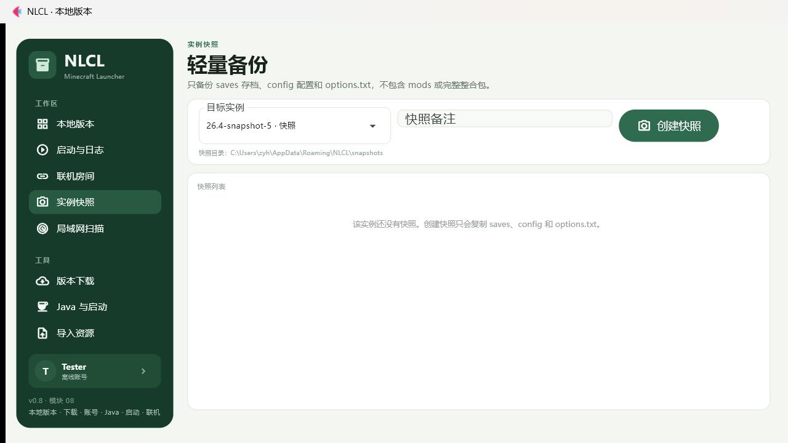

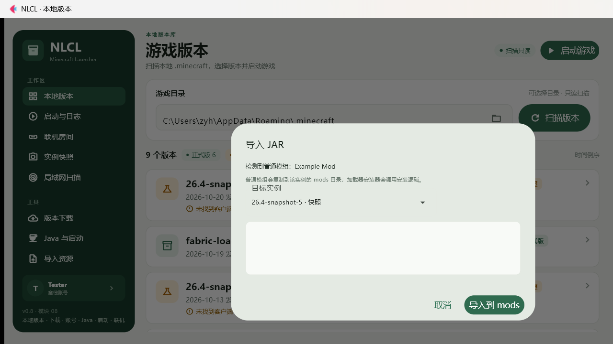

## 下载即用（普通玩家）

如果只是使用启动器，不需要安装 Python：

1. 打开本项目的 **Releases** 页面
2. 下载最新的 `NLCL.exe`
3. 放到任意文件夹
4. 双击运行

首次启动会检查并在线下载 Java / 游戏文件；不会把游戏或 Java 打包进 exe。

> exe 未做商业代码签名，Windows SmartScreen 或杀毒软件可能提示风险。
> 选择“更多信息 → 仍要运行”，或把 exe 所在目录加入杀毒排除项。
> 详细说明见 [打包与发布教程](PACKAGING_AND_RELEASE.md)。

### 5 步开始使用

1. 打开启动器，点击左侧「设置」。
2. 在「Java 默认路径」选择自己的 Java 17 `java.exe`，点击「校验并保存」。
3. 点击左侧「本地版本」→「扫描版本」。
4. 没有游戏时，点击左侧「版本下载」，选择原版 / Fabric / Forge 下载。
5. 回到「本地版本」，选择版本 →「启动游戏」。

账号在左侧顶部的账号卡中管理；皮肤、主题、下载目录、日志行数都在「设置」页。

## 运行源码

在项目目录打开 PowerShell：

```powershell
python -m venv .venv
.\.venv\Scripts\python.exe -m pip install -r requirements.txt
.\.venv\Scripts\python.exe main.py
```

如果虚拟环境已经创建过，只需要执行后两条命令。

> 当前固定 Flet 0.28.3。这个版本的 Windows 桌面运行时包含在 `flet-desktop` 安装包里，不需要首次启动时从 GitHub 下载；之前使用 Flet 1.0.5 时下载中断，会产生 `BadZipFile`。

## 测试

```powershell
.\.venv\Scripts\python.exe -m unittest -v test_version_scanner.py test_version_downloader.py test_java_runtime.py test_download_ui.py test_version_details.py test_account_manager.py test_launch_settings.py test_game_launcher.py test_launch_controller.py test_multiplayer.py test_log_tags.py test_snapshot.py test_lan_scan.py test_import.py test_skin.py test_theme.py test_app_settings.py
```

当前共有 82 个测试，全部通过。

测试不会下载完整游戏，不会删除真实的 `.minecraft` 版本，不会访问微软账号接口，不会启动真实游戏，也不会写真实的 `accounts.json` / `launch_settings.json`。

## 一键打包 exe

### 最简单方式

在项目文件夹双击：

```text
一键打包.bat
```

等待窗口出现：

```text
BUILD SUCCESS
EXE: D:\Users\zyh\Desktop\NLCL\dist\NLCL.exe
```

最终文件：

```text
dist\NLCL.exe
```

已实际打包并运行验证：

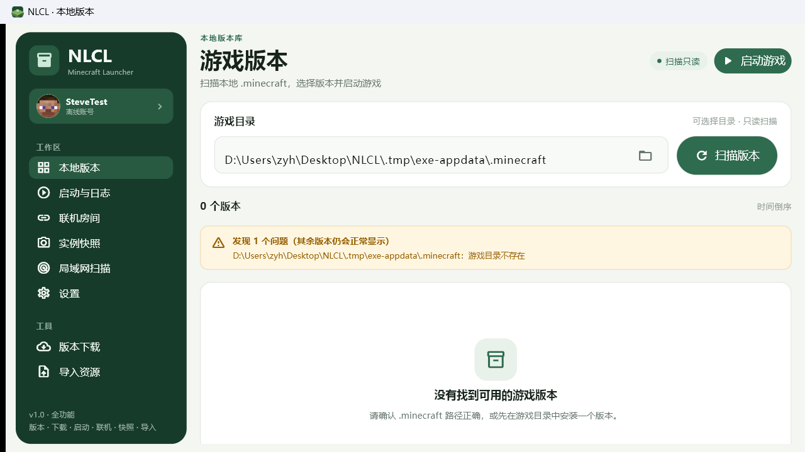

- 单文件大小约 90 MB
- 无黑色控制台
- 已嵌入 assets
- 已设置 exe 图标
- 已用离线账号验证默认史蒂夫头像从打包资源读取成功

### 脚本自动完成

- 检查/创建 `.venv`
- 安装 `requirements.txt`
- 安装 `requirements-build.txt`
- 清理旧 `build` / `dist`
- 调用 `flet pack`（底层 PyInstaller）
- 生成 `--onefile --noconsole` 单文件 exe
- 嵌入 `assets` 资源
- 设置 `assets/app.ico` 图标

### 打包参数说明

- 入口：`main.py`
- 单文件：`--onefile`（`flet pack` 默认）
- 无控制台：`--noconsole`
- 资源：`--add-data "assets;assets"`
- 图标：`--icon "assets\app.ico"`
- 游戏/Java：不打包，运行时在线下载
- 下载目录：保留设置页可修改

### 为什么用 `flet pack` 而不是直接 `pyinstaller main.py`

Flet 桌面程序需要额外的桌面运行器。`flet pack` 会自动带上这些文件；直接 `pyinstaller main.py` 很可能出现白屏、闪退或找不到 Flet 运行器。

完整打包、图标替换、Git、GitHub 上传和 Release 发布教程：

**[PACKAGING_AND_RELEASE.md](PACKAGING_AND_RELEASE.md)**

### 构建依赖

```text
requirements.txt
requirements-build.txt
```

`requirements-build.txt` 内容：

```text
pyinstaller>=6.10,<7
flet-cli==0.28.3
```

## 常见打包/发布问题

### 双击 bat 后窗口一闪而过

用 `cmd` 打开项目目录再运行：

```bat
cd /d "D:\Users\zyh\Desktop\NLCL"
build.bat
```

### exe 白屏 / 找不到资源

确认 `build.bat` 中有：

```bat
--add-data "assets;assets"
```

并确认 `assets\steve.png`、`assets\app.ico` 存在。

### exe 报 “Could not create temporary directory!”

单文件 exe 启动时会先解压到 `%TEMP%`。如果该目录不可写，就会报这个错。

解决：

1. 确认 `C:\Users\你的用户名\AppData\Local\Temp` 存在
2. 清空 `%TEMP%` 里旧的 `_MEI*` 文件夹
3. 确认 C 盘有足够空间
4. 把 exe 放到桌面或普通文件夹运行，不要放在只读目录
5. 暂时把 exe 所在目录加入杀毒排除项
6. 如果仍然不行，用源码运行或改成目录版打包

### 杀毒软件误报

PyInstaller 单文件程序常被误报，不代表有病毒。

1. 把 `dist` 目录加入 Windows Defender 排除项
2. 重新打包
3. 正式发布建议使用代码签名证书

### 图标不更新

关闭所有 NLCL 窗口，然后：

```bat
ie4uinit.exe -show
```

或重启资源管理器。

### Git / GitHub 报错

`git` 不是命令、`remote origin already exists`、`non-fast-forward`、登录 403、Release 上传失败等，全部写在：

**[PACKAGING_AND_RELEASE.md](PACKAGING_AND_RELEASE.md)**

## 当前功能

### 本地版本

- 默认读取 `%APPDATA%\.minecraft`，也可以在界面中修改路径后重新扫描。
- 路径输入框右侧的文件夹按钮会打开 Windows 原生目录选择器；选中后自动扫描。
- 扫描 `versions/<版本目录>/<版本目录>.json`。
- 按发布时间倒序显示版本名称、类型、发布日期；加载器版本显示其依赖的父版本。
- 单个版本 JSON 损坏时只显示一条警告，不影响其他版本。
- 只读扫描，不会修改游戏目录。

### 版本下载、Fabric / Forge 与 Java

- 点击侧栏「版本下载」打开下载弹窗，支持三种安装类型：
  - **原版**：从 Mojang 官方 manifest 获取正式版/快照；
  - **Fabric**：选择 Minecraft 版本和 Fabric Loader 版本；
  - **Forge**：选择 Minecraft 版本和 Forge 版本。
- 版本列表来自 Mojang 官方 `version_manifest_v2.json`，支持搜索和类型筛选。
- 选中版本后自动读取官方 version JSON 的 `javaVersion`，推荐对应 Java：
  - 8 → `jre-legacy`
  - 16 → `java-runtime-alpha`
  - 17 → `java-runtime-gamma`
  - 21 → `java-runtime-delta`
  - 25 → `java-runtime-epsilon`
- 点击 Java 卡片右侧的「下载 Java」会把 Mojang 运行时安装到 `.minecraft/runtime`；已安装时显示实际 `java.exe` 路径。
- 安装 Fabric / Forge 时自动检查并安装该 Minecraft 版本要求的 Java；然后用该运行时执行加载器安装器。
- 下载在后台线程运行，实时显示进度、速度和阶段；完成后会刷新本地版本列表。
- **完成提示可点击**：下载/安装/Java 运行完成后显示「点击关闭窗口」提示，点击即关闭下载弹窗；按钮同时变为「完成并关闭」。
- 失败时保留可读错误和「重试」按钮。

> 进度条基于 minecraft-launcher-lib 的分阶段文件进度换算为总进度；速度通过统计实际 HTTP 响应字节计算。
>
> Fabric / Forge 的版本列表与安装调用 `minecraft-launcher-lib` 的 `mod_loader` 接口；Java 运行时使用 Mojang 官方 runtime manifest。

### 版本详情与删除

- 点击任意本地版本卡片打开详情弹窗。
- 展示版本 ID、类型、发布时间、版本目录、继承版本、客户端 JAR 状态。
- 扫描游戏目录和版本目录下的：
  - `mods`：显示文件名、大小、来源，`.jar.disabled` 标记为已禁用；
  - `resourcepacks`：支持 zip 和文件夹；
  - `shaderpacks`；
  - 整合包清单：Modrinth、CurseForge、MultiMC。
- 「打开版本目录」直接打开资源管理器。
- 「删除此版本」需要两次确认：
  1. 第一次提示会删除什么、不会删除什么；
  2. 第二次要求再次确认，并显示完整版本目录。
- 删除操作只删除 `versions/<版本目录>`，不会删除全局 `mods`、`resourcepacks` 或其他版本。
- 删除成功后自动刷新本地版本列表。

### 账号登录

- 侧栏底部显示当前账号；点击账号卡片打开「账号管理」。
- 支持两种登录方式：
  - **微软账号**：OAuth 2.0 设备码登录。点击后自动生成验证码并打开 `microsoft.com/link`，输入验证码完成授权即可，启动器后台轮询授权状态；
  - **离线账号**：3-16 位字母、数字或下划线，生成标准离线 UUID。
- 登录过程不会阻塞 UI；微软登录显示设备验证码、有效期倒计时和等待动画。
- 微软授权成功后自动完成 Xbox Live / XSTS / Minecraft 认证，不需要复制回调 URL。
- 可以保存多个账号，点击「已保存账号」中的条目切换当前账号。
- 「登出当前账号」会从 JSON 中删除该账号及其 token，并自动切换到下一个账号。
- 重启启动器后自动恢复上次的当前账号，不需要重新登录。
- 账号文件：`%APPDATA%\NLCL\accounts.json`。

> 账号文件保存了微软账号的 access_token / refresh_token，属于本机私密数据，不要提交到版本库或发给别人。
>
> 保存逻辑兼容 Windows Store/MSIX 版 Python 的 AppData 重定向，不会使用跨盘 rename；如果上次写入中断，启动时会尝试从 `accounts.json.tmp` 恢复。
>
> `minecraft-launcher-lib 8.0` 本身没有暴露 device code API，因此设备码请求与轮询按 Microsoft 官方协议实现，后续 Xbox Live / XSTS / Minecraft 接口与 minecraft-launcher-lib 一致。默认使用 mcauth3 提供的公开 device-code 客户端 ID，可通过环境变量 `NLCL_MS_CLIENT_ID` 替换为自己的 Azure 公共客户端。启动器不会接触或保存微软密码。

### Java 与启动设置

- 侧栏「Java 与启动」打开设置面板。
- 「浏览」选择 JDK/JRE 17 的 `bin\java.exe`；也支持选中 `javaw.exe` 后自动切换为同目录的 `java.exe`。
- 选择后在后台执行 `java -version` 校验：
  - 只接受主版本号为 17 的 Java；
  - 校验期间显示加载动画和「正在校验 Java 版本…」；
  - 校验失败时显示实际检测到的版本，不阻塞界面。
- 最小内存和最大内存分别用滑块设置，范围 512 MB - 32 GB；最小内存不会超过最大内存。
- 自定义 JVM 参数以原始字符串保存，供后续启动模块拼接使用。
- 「保存设置」写入 `%APPDATA%\NLCL\launch_settings.json`。

> 配置文件结构包含 `java.path/version/major`、`memory.min_mb/max_mb` 和 `jvm_args`。写文件同样兼容 Windows Store/MSIX 的 AppData 重定向。

### 启动控制台与实时日志

- 侧栏「启动与日志」打开非模态控制台，不再使用独占弹窗。
- **多实例并发**：游戏运行期间启动器不锁定，可以继续「启动新实例」；每个实例有独立进程、独立状态和独立日志。
- 启动前依次检查：
  - 版本目录、版本 JSON、mainClass、客户端 JAR（支持继承版本的 JAR）；
  - `assets/indexes` 资源索引；
  - 当前系统需要的依赖库；
  - Java 路径、Java 17 以及版本 JSON 声明的 Java 主版本；
  - 账号信息；微软账号会先刷新 token。
- 版本文件缺失、Java 版本不匹配、账号失效时，日志会输出具体版本、具体文件和修复建议。
- 启动前自动准备缺失的 Windows natives（`lwjgl.dll` 等）。
- 通过 `minecraft-launcher-lib` 的 `get_minecraft_command()` 构建命令，带入 Java 路径、最小/最大内存和自定义 JVM 参数。
- 日志按实例隔离，实时显示；支持：
  - 「导出日志」：一键写入 `%APPDATA%\NLCL\logs\NLCL-<版本>-<时间>.log`；
  - 「清空日志」；
  - 「停止」当前实例。
- **实例结束后**：进程退出会自动标记为「已退出/已停止/失败」，日志卡片保留可回看；每条已结束实例右侧出现小 ×，也可以选中后点「移除记录」。运行中的实例禁止移除。
- 多个实例独立运行，运行期间可以自由切换侧栏到「本地版本」「联机房间」或「启动与日志」。

> 已使用本机 Java 17 和一个本地 1.20.1 版本实际启动到 Minecraft 标题界面，日志成功捕获 Render thread 输出。

### 局域网联机

- 侧栏「联机房间」打开非模态联机页面。
- **同 WiFi 局域网**
  - 在游戏内进入单人存档，按 Esc → 「对局域网开放」；
  - 启动器监听 Minecraft 的 UDP 局域网广播（`224.0.2.60:4445`），自动识别随机端口；
  - 支持手动填写游戏聊天栏显示的端口；
  - 识别后展示 `本机局域网 IP:端口`，例如 `192.168.1.10:54321`；
  - 一键复制地址，发给同一 WiFi 下的好友。
- **加入房间**
  - 输入好友的 `host:port`；
  - 选择版本和已保存账号；
  - 一键启动新游戏实例，并通过 `--server host --port port` 自动直连。
- 端口识别过程、失败原因和成功地址都会写入页面日志区。
- **跨公网联机**：启动器不再内置 ngrok。需要用户自行准备 FRP 等穿透工具，再把穿透后的地址发给好友。

> Minecraft 原版没有从外部进程直接触发「对局域网开放」的官方 API，因此创建房间需要在游戏内手动点一次「对局域网开放」；启动器负责端口识别和地址展示。加入房间通过直连参数自动完成。

### 局域网房间扫描、收藏和二维码

- 侧栏「局域网扫描」打开房间发现页面。
- 后台监听 `224.0.2.60:4445` 的 Minecraft 局域网广播，解析房间端点和 MOTD。
- 对每个端点执行 Minecraft Server List Ping，补充：
  - 房间名；
  - 游戏版本；
  - 在线玩家 / 最大玩家；
  - 端口与地址。
- 支持收藏/取消收藏，收藏写入 `%APPDATA%\NLCL\lan_favorites.json`。
- 每个房间支持「加入」：匹配本地版本后启动新实例并直连。
- 每个房间支持生成二维码；二维码内容就是 `ip:port`，手机扫码后可直接复制地址。
- 扫描在后台线程运行，界面不阻塞；失败原因显示在状态栏。

> 广播通常只在「对局域网开放」时发送一次。建议先在启动器点扫描，再切回游戏开放；也可以先开放后立即扫描。
>
> 如果房间版本所需的 Java 与当前实例不兼容，会提示先在「启动与日志」中完成一键修复。

### Java 智能预检与实例级绑定

- 在「启动与日志」选择版本时，自动读取该版本 JSON 的 `javaVersion`，计算：
  - 版本需要的 Java 主版本；
  - 当前实例绑定的 Java；
  - 全局「Java 与启动」中的 Java。
- 不兼容时显示黄色提示卡，并可通过「一键修复」弹窗：
  - 下载 Mojang 对应运行时；
  - 校验 `java -version`；
  - 把 Java 路径绑定到该版本（实例级）。
- 绑定写入 `%APPDATA%\NLCL\instance_java.json`，不会修改其他版本，也不会覆盖全局 Java 设置。
- 启动时控制器优先使用实例绑定 Java；没有绑定才使用全局设置。
- 「下载并绑定」复用版本下载页的 Mojang 运行时下载/重试逻辑。

### 实例轻量快照

- 侧栏「实例快照」打开快照页面。
- 快照只包含：
  - `saves/`
  - `config/`
  - `options.txt`
- 不备份 mods、客户端 JAR、资源文件，因此体积小；不是完整整合包导出。
- 支持备注、快照列表、文件数/体积展示。
- 回滚前自动创建 `auto-` 保护快照，再替换当前三个路径。
- 快照目录：`%APPDATA%\NLCL\snapshots`。

### 日志语义标签

- 对每行游戏日志做关键词分类，标签为：
  - `模组冲突`
  - `Java不兼容`
  - `资源加载失败`
  - `正常信息`
- 非正常标签使用不同颜色并在行首显示标签。
- 日志工具栏增加筛选下拉框，可只看某一类问题。
- 导出日志会保留原始文本，方便反馈。

### 拖拽导入 / Modrinth 整合包

- 侧栏「导入资源」提供文件选择入口。
- 支持：
  - 普通 `.jar`：选择目标实例后复制到该实例的 `mods`；
  - Fabric/Forge 安装器 jar：识别后提供加载器安装选项；
  - Modrinth `.mrpack` / 整合包 `.zip`：解析 `modrinth.index.json`，创建独立 `.minecraft` 实例根目录，安装匹配加载器/Java，下载 mods、部署 overrides，并注册到启动列表。
- 独立实例位于 `%APPDATA%\NLCL\instances`，通过注册表加入启动页版本列表。
- 代码包含 Windows `DragAcceptFiles + WM_DROPFILES` 原生拖拽尝试；由于 Flet 0.28 桌面运行器把窗口放在独立进程，原生 drop 事件不一定能转发到 Python。无论是否可用，都可以通过「导入资源」文件选择器完成同一套导入流程。

> Modrinth 导入会下载整合包列出的文件，可能较大；请确保网络和磁盘空间充足。

### 全局等比缩放布局

- 页面在固定的基准画布上布局：**1012×546 逻辑像素**，约等于 1280×720 窗口。
- 窗口尺寸变化时不再使用视觉 `transform`，而是按统一比例重新计算控件树的实际布局尺寸：
  - 宽高、内边距、间距、圆角、字体、图标和输入框字号一起缩放；
  - 侧栏、按钮、文字、版本卡片保持同一套比例；
  - 因为是真实布局缩放，点击命中区域与视觉位置一致。
- 缩放系数按客户区与基准画布的宽高比计算；窗口比例变化时保持统一系数，不做横向/纵向拉伸。
- 允许缩放到基准画布以下（最低 0.35 倍），以便支持 950×500 小窗。
- 根容器固定为实际客户区大小，内部主内容仍自适应剩余宽度，因此右侧/底部不会出现大面积空白。
- 最小窗口尺寸锁定为 **950×500**，窗口不能缩到该尺寸以下。
- 最大缩放限制为 **3.0 倍**；最小缩放 0.35，避免高 DPI 下无限缩小。
- 窗口放大后，启动、首次扫描完成、`on_resized` 时都会重新计算并应用比例。
- 版本列表仍在内部滚动，条目位置和间距比例不变。
- 账号卡仍固定在侧栏 NLCL 标题下方、工作区标签上方。
- 账号、皮肤、下载、版本详情等弹窗也通过 `Page.open` 包装应用当前比例。

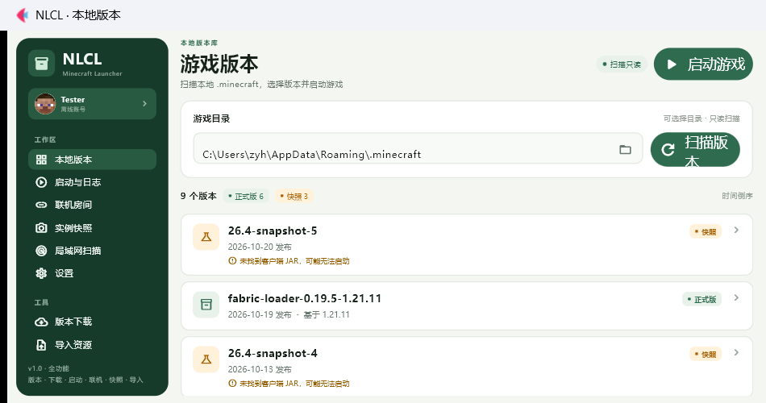

### 三套全局主题

- 内置：
  - 深色原版
  - 浅色
  - 柔和灰绿（默认）
- 设置页切换后立即重建界面颜色。
- 主题写入 `%APPDATA%\NLCL\ui_theme.json`，启动时自动应用。
- 下载、账号、皮肤、启动、联机、快照、导入等已加载 UI 模块的颜色会在切换时同步热替换，重新打开的弹窗也使用新主题。


### 账号侧栏入口与皮肤管理

- 账号组件位于左侧侧栏顶端（NLCL 标题下方、工作区标签上方），显示皮肤头像、名称和账号类型。
- 头像规则：
  - **微软正版账号**：优先读取 `skin_url` 对应的官方皮肤；首次在后台预取并缓存，避免阻塞 UI；
  - **离线账号**：优先使用该账号上次选用的本地皮肤；
  - 没有自定义皮肤时使用随程序附带的 Minecraft 标准史蒂夫皮肤（`assets/steve.png`）。
- 「皮肤管理」支持：
  - 上传标准 `64×64` 或 `64×32` PNG；
  - 校验尺寸和 PNG 格式；
  - 按账号保存历史皮肤；
  - 每个账号独立记录上次选用的皮肤；
  - 完整皮肤预览和 2D 头像吸附预览；
  - 微软账号仍以官方皮肤为头像优先，离线账号使用本地皮肤。
- 皮肤文件位于 `%APPDATA%\NLCL\skins`。


### 独立设置页面

侧栏「设置」不再打开弹窗，改为完整页面，集中管理：

- Java 默认路径、最小/最大内存、自定义 JVM 参数，并在保存前校验 Java 17；
- 版本下载目录；
- 下载限速（KB/s，0 为不限；通过全局 urllib3 读取包装生效，不修改下载模块代码）；
- 全局主题；
- 日志最大保留行数、自动滚动；
- 账号管理和皮肤管理入口。

设置写入 `%APPDATA%\NLCL\app_settings.json`；Java/内存继续使用原 `launch_settings.json`。


## 文件说明

| 文件 | 作用 |
| --- | --- |
| `main.py` | 自适应主窗口、侧栏顶部账号卡、页面路由、主题重建 |
| `version_scanner.py` | 本地版本扫描、JSON 解析、扫描结果数据类 |
| `version_downloader.py` | 官方版本列表、后台下载任务、进度/速度状态 |
| `download_ui.py` | 原版 / Fabric / Forge 下载、Java 入口、进度和完成提示 |
| `version_details.py` | 版本详情扫描、整合包检测、安全删除 |
| `version_details_ui.py` | 版本详情弹窗、两次确认删除 |
| `account_manager.py` | 账号数据模型、JSON 持久化、离线 UUID |
| `microsoft_auth.py` | 微软 OAuth、Xbox Live / XSTS / Minecraft 认证 |
| `account_ui.py` | 账号管理弹窗、微软/离线登录、切换和登出 |
| `launch_settings.py` | Java 17 校验、内存规范化、启动设置 JSON |
| `launch_settings_ui.py` | 旧 Java 设置弹窗（已由独立设置页替代） |
| `game_launcher.py` | 版本完整性检查、natives 准备、JVM 参数、启动命令构建 |
| `launch_controller.py` | 多实例会话、独立进程/日志、异步启动和停止 |
| `launch_console_ui.py` | 非模态启动控制台、实例选择、日志导出/清空、Java 预检 |
| `multiplayer.py` | 局域网端口发现、本地 IP、联机地址解析 |
| `multiplayer_ui.py` | 非模态局域网页面、地址复制、直连启动 |
| `lan_scan.py` | 局域网广播扫描、Server List Ping、收藏、二维码 |
| `lan_scan_ui.py` | 房间扫描页面、房间卡片、收藏、分享二维码、一键加入 |
| `java_runtime.py` | Java 推荐、Mojang 运行时下载、实例 Java 检查 |
| `java_bindings.py` | 实例级 Java 绑定 JSON |
| `snapshot_manager.py` | 轻量快照创建、列表、保护快照和回滚 |
| `snapshot_ui.py` | 快照页面、备注、列表、回滚确认 |
| `log_tags.py` | 日志关键词分类与标签颜色 |
| `mod_import.py` | jar 识别、mod 复制、Modrinth 解析/安装/独立实例 |
| `import_ui.py` | 导入确认弹窗、导入进度 |
| `instance_registry.py` | 独立实例注册表 |
| `drop_support.py` | Windows 原生文件 drop 尝试（失败回退文件选择） |
| `settings_ui.py` | 独立设置页面：Java/内存、下载、限速、日志、主题、账号皮肤 |
| `app_settings.py` | 下载目录、下载限速、日志偏好持久化 |
| `download_throttle.py` | 全局 urllib3 下载限速包装 |
| `theme_manager.py` | 三套主题、主题持久化与 UI 模块颜色热替换 |
| `skin_manager.py` | 皮肤格式校验、历史、账号选择、官方/本地头像渲染 |
| `assets/steve.png` | 内置 Minecraft 标准史蒂夫 64×64 皮肤，作为离线默认头像 |
| `skin_ui.py` | 皮肤上传、历史、2D 头像预览弹窗 |
| `ui_theme.py` | 界面共用的颜色、间距和版本标签样式 |
| `ui_helpers.py` | 日期、字节数、速度格式化，目录比较 |
| `test_version_scanner.py` | 扫描模块单元测试 |
| `test_version_downloader.py` | 下载模块单元测试 |
| `test_java_runtime.py` | Java 推荐与本地版本 Java 读取测试 |
| `test_download_ui.py` | 下载完成提示和加载器安装准备测试 |
| `test_version_details.py` | 详情与删除模块单元测试 |
| `test_account_manager.py` | 账号持久化与登录辅助函数单元测试 |
| `test_launch_settings.py` | Java 校验与启动设置单元测试 |
| `test_game_launcher.py` | 版本完整性检查与启动命令单元测试 |
| `test_launch_controller.py` | 多实例、实例 Java、结束实例移除测试 |
| `test_multiplayer.py` | 局域网地址与端口辅助函数单元测试 |
| `test_log_tags.py` | 日志语义标签测试 |
| `test_snapshot.py` | 快照创建、保护与回滚测试 |
| `test_lan_scan.py` | 广播解析、收藏、二维码、Server List Ping 测试 |
| `test_import.py` | jar 识别、mrpack 解析、实例注册与版本重命名测试 |
| `test_skin.py` | 皮肤格式、上传、历史与头像测试 |
| `test_theme.py` | 主题持久化与颜色应用测试 |
| `test_app_settings.py` | 设置持久化与下载限速测试 |
| `requirements.txt` | 运行依赖（Flet、minecraft-launcher-lib、requests、segno、Pillow） |
| `requirements-build.txt` | 打包依赖（PyInstaller、flet-cli） |
| `dist/NLCL.exe` | 本次已构建的单文件程序（不上传源码仓库） |
| `dist/SHA256.txt` | 当前 exe 的 SHA256 校验值 |
| `build.bat` | 一键打包实际执行脚本 |
| `一键打包.bat` | 双击入口，调用 build.bat |
| `assets/app.ico` | exe 图标 |
| `assets/app.png` | 图标源图 |
| `assets/steve.png` | 内置默认史蒂夫皮肤 |
| `PACKAGING_AND_RELEASE.md` | 打包、Git、GitHub Release 傻瓜教程 |
| `RELEASE_NOTES_v1.0.0.md` | GitHub Release 可直接复制的发布说明 |

> `version_scanner.py` 的扫描逻辑未改动。

> 仓库中已有的 `launcher_core.py`、`utils.py`、`test_core.py` 是更早的骨架，本次没有修改它们；`account_manager.py` 已从旧骨架重写为正式账号模块。
